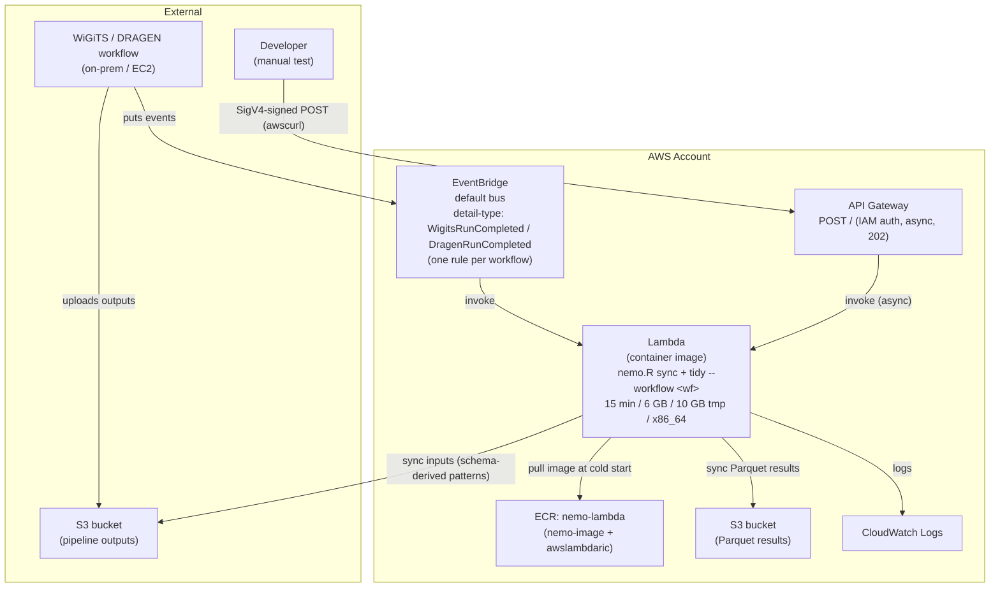

# Architecture

How things stand today: one stack, `NemoStack` (`cdk/lib/NemoStack.ts`), with no VPC
and no database. An earlier plan for a VPC + RDS Proxy + Postgres pair of stacks, with
a TypeScript `handler.ts`, was dropped before it was built: nemo writes Parquet to S3
instead of Postgres, so the Lambda needs nothing but internet access to S3.



## Event payload

```json
{
  "detail-type": "WigitsRunCompleted",
  "detail": {
    "input_id": "...",
    "workflow": "wigits"
  }
}
```

The S3 input path is constructed in the handler from `S3_INPUT_BUCKET` + the workflow's
`s3InputPrefix` + `input_id` — not passed in the event. The workflow is
`detail.workflow` if given, else the workflow whose `detailType` matches `detail-type`,
else `nemoWorkflow`.

The same `detail` shape is POSTed to API Gateway or passed to `aws lambda invoke` for
manual runs (see `lambda/README.md`).

## NemoStack

- **ECR Repo**: imported by name (`nemo-lambda`) via `fromRepositoryName`, not
  created by the stack. It holds the Lambda container image. Lambda can only pull from
  ECR — GHCR and Docker Hub are not valid Lambda image sources.
- **S3**: both buckets are imported by name from CDK context. Input holds the WiGiTS /
  DRAGEN pipeline outputs; output receives the Parquet results.
- **IAM Role**:
  - base: `AWSLambdaBasicExecutionRole` (CloudWatch Logs)
  - added: `s3:GetObject` + `s3:ListBucket` on the input bucket, `grantPut` +
    `s3:ListBucket` on the output bucket (`aws s3 sync` lists the destination)
  - no VPC access, no Secrets Manager, no RDS — nothing to authenticate against
- **Function**:
  - container-based, not ZIP; `handler` and `runtime` both come `FROM_IMAGE`
  - `timeout`: 15 min (the Lambda maximum)
  - `memorySize`: from `lambdaMemoryMB` context, default 6 GB
  - `ephemeralStorageSize`: from `lambdaEphemeralStorageMB` context, default 10 GB
    (`/tmp` holds both the synced inputs and the Parquet outputs)
  - `retryAttempts`: 0 — a retried async run would mint a new `output_id` and leave a
    partial output prefix behind
  - environment: `S3_INPUT_BUCKET`, `S3_OUTPUT_BUCKET`, `NEMO_WORKFLOWS`
    (the `workflows` context as JSON), `NEMO_WORKFLOW` — read by `handler.py`
  - architecture: default `x86_64`, so the image must be built
    `--platform linux/amd64` even though `nemo-image` is multi-arch
  - defaults left alone: unlimited reserved concurrency, no dead letter queue, no
    tracing, default CloudWatch log retention
  - implications: 10–30 sec cold start, 10 GB image size limit, each concurrent
    execution gets its own container instance
- **EventBridge rules**: one per `workflows` entry, on the default bus, matching its
  `detailType` (e.g. `WigitsRunCompleted`), targeting the Lambda directly. This is the
  primary trigger.
- **API Gateway**: `nemo-manual` REST API with a single POST method, kept as a
  manual escape hatch. Non-proxy integration that sets
  `X-Amz-Invocation-Type: Event`, so it returns 202 immediately and the Lambda runs
  async — the 15 min timeout would otherwise blow past API Gateway's 29 sec limit.
  Non-proxy also means the POST body *is* the Lambda event (no `body` wrapper).
  - auth: `AuthorizationType.IAM` — requests must be SigV4-signed (`awscurl
    --service execute-api`) by a principal with `execute-api:Invoke`. Added after a
    Security Hub "Lambda accessible through API Gateway without authorization" finding
    on the original open endpoint (`TidywigitsStack`, May 2026).
  - `cloudWatchRole: false`: stage logging is off, so the stack does not create the
    account-wide `AWS::ApiGateway::Account` + CloudWatch role.
- **CfnOutput**: Lambda function name (for direct invocation) and API URL.

## Python handler

- nemo is invoked through its CLI (`nemo.R sync` then `nemo.R tidy --workflow <wf> ...`), exposed by the
  image; the handler does not call R functions directly.
- `handler.py` is Python rather than TypeScript because the base image is a conda env
  that already ships Python — adding Node.js just to shell out to an R CLI would only
  grow the image. `awslambdaric` supplies the Lambda Runtime API polling loop that a
  managed runtime would otherwise provide.
- `lambda/Dockerfile` builds `FROM ghcr.io/tidywf/nemo-image:<VERSION>` and adds
  `awslambdaric`, `awscli` and `python-ulid` via the conda env's own pip.
