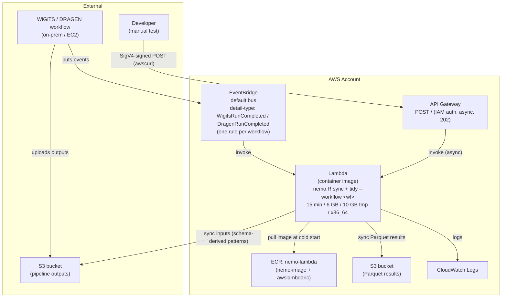

# Architecture

One stack, `NemoStack` (`cdk/lib/NemoStack.ts`).



## Event payload

```json
{
  "detail-type": "WigitsRunCompleted",
  "detail": {
    "input_id": "...",
    "workflow": "wigits"
  }
}
```

  | Field          | Source                                                                                             |
  | ---            | ---                                                                                                |
  | Workflow       | `detail.workflow`, else the workflow whose `detailType` matches `detail-type`, else `nemoWorkflow` |
  | S3 input path  | `S3_INPUT_BUCKET` + workflow's `s3InputPrefix` + `input_id` (not in the event)                     |
  | S3 output path | `S3_OUTPUT_BUCKET` + workflow's `s3OutputPrefix` + ULID minted by the handler                      |

The same `detail` shape is POSTed to API Gateway or passed to
`aws lambda invoke` for manual runs (see `lambda/README.md`).

## NemoStack

  | Resource                  | Config                                                                                                  | Why                                                                                            |
  | ---                       | ---                                                                                                     | ---                                                                                            |
  | ECR `nemo-lambda`         | imported via `fromRepositoryName`                                                                       | Lambda can only pull from ECR, not GHCR / Docker Hub                                           |
  | S3 input / output         | imported by name from CDK context                                                                       |                                                                                                |
  | IAM role                  | `AWSLambdaBasicExecutionRole` + `s3:GetObject`/`ListBucket` (input), `grantPut` + `ListBucket` (output) | `aws s3 sync` lists the destination                                                            |
  | EventBridge rules         | one per `workflows` entry, default bus, match `detailType`, target Lambda                               | primary trigger                                                                                |
  | API Gateway `nemo-manual` | single POST, non-proxy, `X-Amz-Invocation-Type: Event` → 202                                            | manual escape hatch; async because 15 min Lambda > 29 s API GW limit; POST body *is* the event |
  | API Gateway auth          | `AuthorizationType.IAM` (SigV4, `execute-api:Invoke`)                                                   | Security Hub finding on the old open endpoint                                                  |
  | API Gateway logging       | `cloudWatchRole: false`                                                                                 | avoids account-wide `AWS::ApiGateway::Account` resource                                        |
  | CfnOutput                 | function name, API URL                                                                                  |                                                                                                |

### Lambda function

  | Setting                | Value                                                                           | Why                                                             |
  | ---                    | ---                                                                             | ---                                                             |
  | Package                | container image                                                                 |                                                                 |
  | `timeout`              | 15 min                                                                          | Lambda max                                                      |
  | `memorySize`           | `lambdaMemoryMB`, default 6 GB                                                  |                                                                 |
  | `ephemeralStorageSize` | `lambdaEphemeralStorageMB`, default 10 GB                                       | `/tmp` holds synced inputs + Parquet outputs                    |
  | `retryAttempts`        | 0                                                                               | a retry would mint a new `output_id`, leaving a partial prefix  |
  | Architecture           | `x86_64` (default)                                                              | build with `--platform linux/amd64`; `nemo-image` is multi-arch |
  | Environment            | `S3_INPUT_BUCKET`, `S3_OUTPUT_BUCKET`, `NEMO_WORKFLOWS` (JSON), `NEMO_WORKFLOW` |                                                                 |
  | Left at default        | concurrency, DLQ, tracing, log retention                                        |                                                                 |

## Python handler

Python because the base image is a conda env that already ships it.
